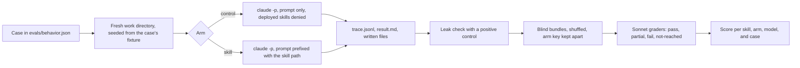

# Headless Skill Evaluations: Handoff Draft

Status: draft, for handoff to agent-setup. The user decided on 2026-11-17 that the method below becomes a proper tool
on the agent-setup side, inside its skill evaluation redesign (`docs/plans/evaluation/skill-evaluation-redesign.md`
there, read at agent-setup commit `25bd8787`). This draft records what the hand-run method did, what it learned, and
which fixtures exist, so the redesign starts from evidence. It decides nothing for agent-setup.

## What Was Run

On 2026-11-17, agents ran every eval case of `idea-brainstorming`, `technical-design`, and `implementation-planning`
(52 cases) as headless Claude Code sessions, on Sonnet 5.5 and Opus 5.5, once without the skill and once with it. The
results are in `docs/evaluations/2026-11-17-pipeline-skills-round-1.md` (28 self-contained cases) and
`docs/evaluations/2026-11-17-pipeline-skills-round-2.md` (24 cases with fixtures). Including fix checks and reruns,
about 256 runs took a median of 48 seconds each and at most 509 seconds; 6.2 hours of agent time ran 12 to 20 at a
time. Claude Code reported about 62 USD of API-equivalent cost for round 2's 116 runs, drawn from the subscription.

The method found two real skill gaps (both fixed and verified), three defective eval cases, and four defective
fixtures. That is the evidence that it is worth a tool.

## The Method



1. **Prepare the skill copy.** Copy each skill's tracked files except `evals/` to a scratch skills directory, so the
   skill arm cannot read its own cases.

2. **Seed the workspace.** Create an empty work directory per run. When the case has a `fixture` field, copy that
   directory into it. When the case has plain-string `conversation` entries, prepend them to the prompt as "Earlier in
   this conversation:" lines. Object-shaped turns (later user turns with an expected response) are not run; their
   outcomes are graded not-reached.

3. **Run headless.** In the work directory, under a 1200-second timeout:

   ```bash
   claude -p "<prompt>" --model <model> --output-format stream-json --verbose \
     --no-session-persistence --disable-slash-commands --permission-mode acceptEdits \
     --allowedTools Read Glob Grep Write Edit
   ```

   The skill arm prefixes the prompt with "Read the skill at `<copy>/SKILL.md` and follow
   it for this task." and adds `--add-dir <skills copy>`. The control arm adds
   `--disallowedTools "Read(//<home>/.config/claude/skills/**)"`.

4. **Check for leaks.** Search every control trace for the subject skills' frontmatter in tool results, and run the
   same search over the skill arm as a positive control; it must match every skill run.

5. **Bundle blind.** For each run, write a bundle holding the case prompt (with any earlier turns), the fixture path,
   the behavior and numbered outcomes, the final response, every file the run created or changed, whole, and the tool
   calls with every call that touched a skill path removed. Shuffle bundle names with a fixed seed and write the arm
   key to a separate file. Split the bundles into groups of similar total size.

6. **Grade.** One Sonnet subagent per group of about 32 bundles grades every outcome pass, partial, fail, or
   not-reached, with at most 25 words of evidence, into a JSON Lines file. Not-reached is only for a later stage the
   run correctly stopped before. Graders may read the named fixture directory, but not the skill or its eval file.

7. **Score.** Join grades with the key. Pass counts 1 and partial 0.5; not-reached is excluded. Report per skill,
   arm, and model, and per case. List every skill-arm fail and partial with its evidence.

8. **Verify the decisive grades.** Read the runs behind every skill-arm miss and behind the largest control-arm
   gaps, and decide for each whether it is a skill gap, a case defect, or a fixture defect, before changing anything.

## Learnings

### Contamination

- **`--add-dir` exposes the directory to both arms.** Given to the control arm too, it let 55 of 56 control runs find
  and read the skill. Pass it to the skill arm only.
- **Global instructions lead the control arm to the deployed skills.** With skills disabled, 10 of 56 control runs
  still read `~/.config/claude/skills/<name>/SKILL.md`, because the user's instructions name the skills and `Read` was
  allowed everywhere. One `Read(path)` deny rule covers every file-reading tool, and closed it.
- **A leak check needs a positive control.** A search that finds nothing in the control arm proves nothing until the
  same search finds the skill in every skill-arm trace.
- **The skill arm measures following, not discovery.** The prompt names the skill's path, so the run never tests
  whether the agent would load the skill on its own. Trigger behavior needs its own measurement, as
  `docs/evaluations/2026-11-16-github-and-history-triggers.md` did.

### Cases and Fixtures

- **A case that names supplied material needs a fixture.** `10-compatible-migration` asked to plan "the accepted
  migration" with no design present; the skill arm correctly refused to plan and scored 0.31 against the base model's
  1.00. The 24 material-dependent cases now name fixtures.
- **A fixture defect shows only when a careful run trips on it.** Four planning fixtures claimed accepted designs that
  contradicted their spec or relied on infrastructure the repository lacked. Skill runs routed the gaps back to
  design, as the skill requires; control runs planned over them. The cases were meant to test other behavior, so
  the designs were completed and the cases rerun. Expect more such defects in cases where both arms passed.
- **Fixtures must look like real repositories.** Nothing in a fixture names an evaluation, a grader, or the expected
  behavior, and no instruction file hints at the outcome. The older `handoff-repo` and `small-config-repo` fixtures
  still carry evaluation wording in their `README.md` or `AGENTS.md`.
- **Outcomes go stale when a skill changes.** `small-change-arc42` still expected applicability statements the skill
  had replaced with omitting empty sections. Grading against a stale outcome punishes the skill for its own rule.
- **One run per cell is coarse.** A single disagreement moves a case score by a large step. Fix checks used three runs
  per model; a gap on one model in one run is a lead, not a finding.

### Grading

- **Truncating written files biases against the skill.** The first bundle script cut each file at 20,000 characters.
  Graders marked unseen sections partial, and 7 of 7 truncated round 1 bundles were skill-arm runs. Include files
  whole; tell graders to read long files to their end.
- **Graders need the fixture.** Outcomes such as "preserves the draft's decisions" cannot be graded from the response
  alone.
- **Blinding is partial.** Skill-arm responses often say "the skill requires …". Removing skill-path tool calls hides
  the setup, not the influence.
- **Not-reached needs a strict definition.** Without it, graders excuse a run that stopped for no reason.
- **Sonnet graders have not been calibrated against human labels.** Every decisive grade was checked against its run
  by hand instead. The redesign's principle that a model grade counts only after calibration still applies.

### Operations

- **Opus 5.5 subagents were stopped by the API safeguards** with `reasoning_extraction` on ordinary briefs (fixture
  writing, research, review). Reruns on Sonnet completed. A harness should treat that error as an invalid attempt,
  not a failed outcome, and record the request ID.
- **Pre-commit stashes unstaged changes on every commit.** Committing while subagents edited the same tree wiped
  their in-flight edits. Never commit in the tree a lane or a run is reading from.
- **Concurrency of 12 to 20 headless runs** caused no rate-limit failures on the subscription.

## Fixtures

All fixtures live under `<skill>/evals/fixtures/` in this repository, are named by a case's `fixture` field, and come
with a `workspace` object (setup, working directory, allowed writes, cleanup):

| Skill                     | Fixture                                                                                                                                                                                                                                                   | Cases                                                                    |
| ------------------------- | --------------------------------------------------------------------------------------------------------------------------------------------------------------------------------------------------------------------------------------------------------- | ------------------------------------------------------------------------ |
| `idea-brainstorming`      | `handoff-repo`, `app-only-repo`                                                                                                                                                                                                                           | `handoff-fidelity`, `backward-refinement`                                |
| `technical-design`        | `tool-library-draft-repo`, `token-auth-repo`, `export-quota-repo`, `tenant-export-draft-repo`, `tenant-export-spec-repo`, `scheduled-reports-repo`, `catalog-repo`, `delivery-design-repo`, `retention-spec-adrs-repo`                                    | the ten cases listed in its `evals/behavior.json` with a `fixture` field |
| `implementation-planning` | `small-config-repo`, `webhook-retry-repo`, `migration-design-repo`, `dedup-plan-repo`, `tenant-export-design-repo`, `review-plan-repo`, `account-export-repo`, `report-sharing-repo`, `catalog-design-repo`, `design-variants-repo`, `issue-tracked-repo` | thirteen cases with a `fixture` field                                    |

Each case's `fixture` field is the authority for which fixture it uses. Several fixtures carry Python packages with
pytest suites and their own `pyproject.toml` ruff settings; the repository's hooks lint them.

## How This Maps to the agent-setup Redesign

The redesign plans promptfoo as the runner, inside the moatbox sandbox. The hand-run method answers or sharpens
several of its points:

- **Fresh workspaces** correspond to promptfoo's `copy_working_dir` (absent from the pinned 0.122.2). The fixture copy
  here is the same idea; the `fixture` field gives the source directory.
- **Arms.** The control arm needs both an empty skill set and a guard against the user's deployed skills. In a sandbox
  that mounts only the candidate skill, the second leak cannot happen, which is a reason to wait for the sandbox.
- **Skill loading.** promptfoo's `skill-used` assertion and the skill-load detection design cover discovery; the
  method here bypassed discovery by naming the path. A harness should support both arms: told the path, and left to
  discover.
- **Case import.** Cases now use `fixture`, `workspace`, and `conversation` (strings for earlier turns, objects for
  later turns with an expected response). A converter must handle all three and keep unsupported shapes visible.
- **Grading free-text outcomes.** Blind Sonnet graders with the pass, partial, fail, not-reached scale and capped
  evidence worked in practice; `llm-rubric` or `agent-rubric` could carry the same brief. Calibration against human
  labels is still open.
- **Known answers.** Round 1's `10-compatible-migration` before its fixture, and the four unsettled planning fixtures
  before their repair, are known cases where the skill arm should refuse or route gaps back. The repaired cases are
  known passes. Either set can test a harness, beside the CLI UX result the redesign names.

## Open Questions for agent-setup

- Whether the tool keeps the "told the path" arm beside the discovery arm, or measures following through discovery
  only.
- Which grader model and calibration set make a model grade count.
- How many repetitions per cell the first live run uses, given the coarseness of one run.
- Whether the converter or the case schema owns the mapping of plain-string `conversation` entries to earlier turns.

## Appendix: The Hand-Run Scripts

These ran from an untracked scratch directory and are kept here verbatim so the method can be rebuilt. Paths are the
author's; the redesign replaces them.

### `run.sh`

```bash
#!/usr/bin/env bash
# Run each case in cases.tsv (skill<TAB>id) once per model and arm as a headless Claude Code session with
# skills disabled. The skill arm points the prompt at a copy of the skill without its evals/ folder.
# Usage: run.sh <arm: control|skill> <model> [jobs]
set -euo pipefail
arm=$1
model=$2
jobs=${3:-3}
here=$(cd "$(dirname "$0")" && pwd)
repo=/home/user/src/agent-skills
base=/var/tmp/pipeline-evals

run_one() {
  local skill=$1 id=$2
  local dir="${base}/runs/${arm}${RUN_TAG:-}-${model}/${skill}/${id}"
  rm -rf "${dir}"
  mkdir -p "${dir}/work"
  local cases="${repo}/engineering/${skill}/evals/behavior.json"
  local fixture
  fixture=$(jq -r --arg id "${id}" '.cases[] | select(.id==$id) | .fixture // empty' "${cases}")
  if [[ -n "${fixture}" ]]; then
    cp -a "${repo}/engineering/${skill}/evals/${fixture}/." "${dir}/work/"
  fi
  local prompt
  prompt=$(jq -r --arg id "${id}" '.cases[] | select(.id==$id) | .prompt' "${cases}")
  # Prior turns given as plain strings are earlier context; object turns are later turns, which stay ungraded.
  local history
  history=$(jq -r --arg id "${id}" '.cases[] | select(.id==$id) | [.conversation // [] | .[] | strings]
    | if length > 0 then "Earlier in this conversation:\n" + (map("- " + .) | join("\n")) + "\n\n" else "" end' "${cases}")
  prompt="${history}${prompt}"
  if [[ "${arm}" == "skill" ]]; then
    prompt="Read the skill at ${base}/skills/${skill}/SKILL.md and follow it for this task.

${prompt}"
  fi
  printf '%s\n' "${prompt}" >"${dir}/prompt.txt"
  local extra=()
  if [[ "${arm}" == "skill" ]]; then
    extra=(--add-dir "${base}/skills")
  else
    local deployed="//home/user/.config/claude/skills/**"
    extra=(--disallowedTools "Read(${deployed})")
  fi
  local start=${SECONDS}
  (cd "${dir}/work" && timeout 1200 claude -p "${prompt}" \
    --model "${model}" \
    --output-format stream-json --verbose \
    --no-session-persistence \
    --disable-slash-commands \
    --permission-mode acceptEdits \
    --allowedTools 'Read' 'Glob' 'Grep' 'Write' 'Edit' \
    "${extra[@]}" \
    >"${dir}/trace.jsonl" 2>"${dir}/stderr.txt") || echo "exit $?" >"${dir}/error.txt"
  jq -r 'select(.type=="result") | .result' "${dir}/trace.jsonl" >"${dir}/result.md" || true
  printf '%s\t%s\t%s\t%ss\n' "${skill}" "${id}" "$([[ -f ${dir}/error.txt ]] && cat "${dir}/error.txt" || echo ok)" \
    "$((SECONDS - start))" >>"${base}/runs/${arm}${RUN_TAG:-}-${model}.log"
}

pids=()
while IFS=$'\t' read -r skill id; do
  [[ -n "${skill}" ]] || continue
  run_one "${skill}" "${id}" &
  pids+=($!)
  if [[ "${#pids[@]}" -ge "${jobs}" ]]; then
    wait "${pids[0]}"
    pids=("${pids[@]:1}")
  fi
done <"${CASES:-${here}/cases.tsv}"
wait
```

### `build_bundles.py`

```python
"""Build blind grading bundles from headless eval runs; write the arm key separately."""
import json, os, pathlib, random, sys

repo = pathlib.Path('/home/user/src/agent-skills/engineering')
base = pathlib.Path('/var/tmp/pipeline-evals')
grading = base / os.environ.get('GRADING', 'grading')
runs, out = base / os.environ.get('RUNS', 'runs'), grading / 'bundles'
out.mkdir(parents=True, exist_ok=True)
cases = {}
for s in ['idea-brainstorming', 'technical-design', 'implementation-planning']:
    for c in json.load(open(repo / s / 'evals/behavior.json'))['cases']:
        cases[(s, c['id'])] = c
items = [(am.name, d.parent.name, d.name, d) for am in sorted(runs.iterdir()) if am.is_dir()
         for d in sorted(am.glob('*/*'))]
random.seed(17)
random.shuffle(items)
key = {}
for i, (am, skill, cid, d) in enumerate(items):
    bid = f"b{i:03d}"
    key[bid] = {'arm_model': am, 'skill': skill, 'case': cid}
    c = cases[(skill, cid)]
    trace = []
    for line in open(d / 'trace.jsonl'):
        try:
            e = json.loads(line)
        except ValueError:
            continue
        if e.get('type') == 'assistant':
            for b in e['message'].get('content', []):
                if b.get('type') == 'tool_use':
                    inp = json.dumps(b['input'])
                    if 'pipeline-evals/skills' in inp or '.config/claude/skills' in inp:
                        continue  # keep the arm blind
                    trace.append(f"{b['name']} {inp[:200]}")
    started = (d / 'prompt.txt').stat().st_mtime
    files = [f"### {f.relative_to(d / 'work')}\n\n{f.read_text(errors='replace')}"
             for f in sorted((d / 'work').rglob('*')) if f.is_file() and f.stat().st_mtime >= started]
    history = [t for t in c.get('conversation', []) if isinstance(t, str)]
    prompt = ("Earlier in this conversation:\n" + "\n".join(f"- {t}" for t in history) + "\n\n" if history else "") + c['prompt']
    fixture = (f"\n\n## Workspace\nThe run started in a copy of `{repo / skill / 'evals' / c['fixture']}`; read it as needed.\n"
               if c.get('fixture') else "")
    outcomes = "\n".join(f"{n}. {o}" for n, o in enumerate(c['outcomes'], 1))
    (out / f"{bid}-{skill}.md").write_text(
        f"# Bundle {bid}\n\n## Case prompt (as the user wrote it)\n{prompt}{fixture}\n\n"
        f"## Behavior under test\n{c['behavior']}\n\n## Outcomes to grade\n{outcomes}\n\n"
        f"## Final response\n{(d / 'result.md').read_text()}\n\n"
        f"## Files the run wrote\n{chr(10).join(files) or '(none)'}\n\n"
        f"## Tool calls\n{chr(10).join(trace) or '(none)'}\n")
json.dump(key, open(grading / 'key.json', 'w'), indent=1)
groups, tot = [[] for _ in range(int(sys.argv[1]))], [0] * int(sys.argv[1])
for f in sorted(out.iterdir(), key=lambda p: -p.stat().st_size):
    i = tot.index(min(tot)); groups[i].append(f.name); tot[i] += f.stat().st_size
for i, g in enumerate(groups, 1):
    (grading / f'group-{i}.txt').write_text('\n'.join(sorted(g)) + '\n')
    print(i, len(g), tot[i - 1])
```

### `score.py`

```python
"""Score blind grades against the arm key: per skill and arm-model, and per case."""

import collections
import json
import os
import pathlib

grading = pathlib.Path("/var/tmp/pipeline-evals") / os.environ.get("GRADING", "grading")
key = json.loads((grading / "key.json").read_text())
value = {"pass": 1.0, "partial": 0.5, "fail": 0.0}
skill_cells = collections.defaultdict(list)
case_cells = collections.defaultdict(dict)
fails = []
seen = set()
for path in sorted(grading.glob("grades-*.jsonl")):
    for line in path.read_text().splitlines():
        if not line.strip():
            continue
        row = json.loads(line)
        seen.add(row["bundle"])
        meta = key[row["bundle"]]
        if meta["case"] in os.environ.get("EXCLUDE", "").split(","):
            continue
        scored = [value[g["grade"]] for g in row["grades"] if g["grade"] in value]
        score = sum(scored) / len(scored) if scored else None
        if score is not None:
            skill_cells[(meta["skill"], meta["arm_model"])].extend(scored)
        case_cells[(meta["skill"], meta["case"])][meta["arm_model"]] = score
        for g in row["grades"]:
            if g["grade"] in ("fail", "partial") and meta["arm_model"].startswith("skill"):
                fails.append((meta["skill"], meta["case"], meta["arm_model"], g["outcome"], g["grade"], g["evidence"]))
missing = sorted(set(key) - seen)
print("missing bundles:", missing or "none")
arms = ["control-sonnet", "skill-sonnet", "control-opus", "skill-opus"]
print("\nskill\t" + "\t".join(arms))
for skill in sorted({s for s, _ in skill_cells}):
    cells = [skill_cells[(skill, a)] for a in arms]
    print(skill + "\t" + "\t".join(f"{sum(c) / len(c):.2f}" if c else "-" for c in cells))
print("\ncase\t" + "\t".join(arms))
for (skill, case), by_arm in sorted(case_cells.items()):
    row = [by_arm.get(a) for a in arms]
    print(f"{skill}/{case}\t" + "\t".join("-" if v is None else f"{v:.2f}" for v in row))
print("\nskill-arm fails and partials:")
for f in fails:
    print("\t".join(str(x) for x in f))
```

### Grading Brief

```markdown
# Brief: grade agent runs against expected outcomes

## Outcome
Each bundle in your group gets a grade for every numbered outcome, with evidence. You are done when your JSON Lines file has one line per bundle, and every line grades every outcome listed in that bundle.

## Context
Each bundle under /var/tmp/pipeline-evals/grading-round2/bundles/ is one headless Claude Code run of a single-turn request. A bundle holds the user's prompt, the behavior under test, numbered outcomes, the run's final response, any files the run wrote, and its tool calls. Runs came from different setups. The setup is deliberately hidden, so judge only what the bundle shows. The runs could not receive a reply from the user: the session ended after the final response. When the prompt opens with "Earlier in this conversation", those lines are prior turns the run received as context.

Most bundles have a Workspace section naming a fixture directory: the small repository the run started in. Read files in that directory when an outcome depends on them, for example whether a design preserved a supplied draft's decisions or whether a plan cited real paths. Read nothing else under that skill's folder: not its SKILL.md and not its evals file.

## How to grade each outcome
- **pass:** the response, files, or tool calls clearly show the outcome.
- **partial:** the outcome is addressed but incompletely, or only implicitly.
- **fail:** the outcome is missing or contradicted.
- **not-reached:** the outcome describes a later stage, such as a handoff after confirmation, and the run correctly stopped earlier to ask the user a question the request made necessary. Use this only when stopping was the right call; a run that stops for no good reason fails the outcomes it skipped.

Grade the substance, not wording or headings. An outcome phrased as "does not X" passes when the run avoids X. Quote at most 25 words of evidence per grade, or name the file and section.

## Rules
- Read only the bundles named in your group file and the fixture directories they name. Write only your output file.
- Keep grading independent per bundle; another bundle on the same case is not a reference answer.
- Use sequential-thinking only for an outcome you find genuinely ambiguous.

## Result
Write /var/tmp/pipeline-evals/grading-round2/grades-<group>.jsonl. Each line is one JSON object:
{"bundle": "b012", "grades": [{"outcome": 1, "grade": "pass", "evidence": "..."}, ...], "note": "optional one sentence on anything notable"}
Then reply with the file path, the bundle count, and the count of each grade. Keep the reply under 80 words.
```
