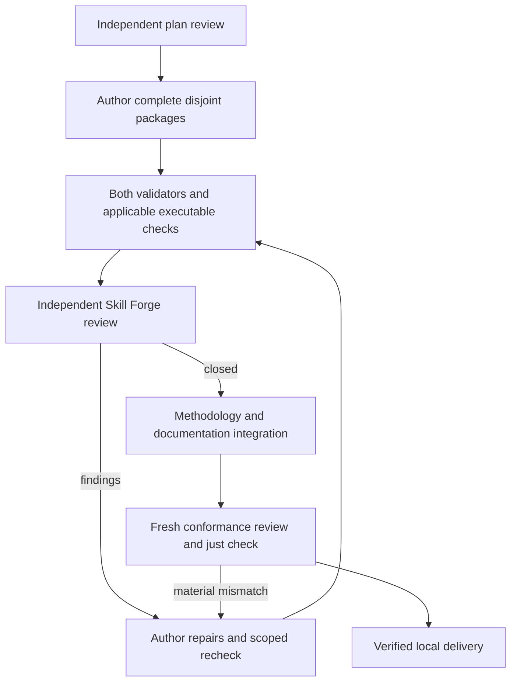

# Reverse-engineering skill set implementation plan

## Accepted outcome and scope

Create twelve portable, self-contained skills directly under `reverse-engineering/`. Preserve existing analytical\
reasoning while removing private-project defaults, names, paths, symbols, and adapters. Execution dependencies remain\
explicit and are discovered per selected route. Research capture/indexing stays with project-specific documentation\
setups.

The four initial source skills come from [wshobson/agents][agents], revision\
`0874a27b17a22e2b7c2e2bcd725768e0803cad06`. Selected additional material comes from [yaklang/hack-skills][hack],\
revision `6fbf0bc8d5c71830d62543a308d8744606c43d7c`. Six authored tool/process skills are generalized from existing\
project-local workflows. Their public upstream source relationships remain in package attributions; private source\
material is not a published reference.

## Package boundaries

| Package                         | Required job                                                                                      |
| ------------------------------- | ------------------------------------------------------------------------------------------------- |
| reverse-engineering-methodology | Investigation process, triage, tool selection, evidence, discriminating experiments               |
| binary-analysis-patterns        | Native code interpretation, recovered data/control flow, mitigation indicators                    |
| anti-reversing-techniques       | Debugger and VM detection, targeted circumvention, packing and non-VM deobfuscation               |
| protocol-reverse-engineering    | Framing, messages, state, evidence-backed parsers and controlled active experiments               |
| memory-forensics                | Capture/platform/symbol validation, correlated indicators, artifact extraction and limits         |
| ghidra-firmware-analysis        | GUI/MCP or headless analysis, heuristic refinement, metadata generation/application, preservation |
| radare2-firmware-analysis       | Loading hypotheses, queries, disagreement analysis, donor matching, state replay                  |
| arm-assembly                    | ARMv7/AArch32 interpretation, ABI and flag effects, system-code context                           |
| crypto-analysis                 | Construction and authenticated-byte recovery, conditional weakness analysis, concrete validation  |
| qemu-emulation                  | Host/guest prerequisite diagnosis, user/system selection, bounded runtime observations            |
| symbolic-execution-tools        | Bounded angr/Triton branches, explicit machine state, assumptions, exploration limits, replay     |
| vm-and-bytecode-reverse         | Virtual ISA/state/handler recovery, bytecode extraction, validated decoder and behavioral model   |

Each package remains independently usable. Specialist names offer depth, without file references outside the package.\
Anti-debugging and non-VM deobfuscation merge into anti-reversing. Deep interpreter recovery belongs in the bytecode\
skill. Protection-bypass material contributes identification and runtime implications; exploit construction is outside\
this set. Generic maze solving does not become a bytecode requirement.

## Preservation and new behavior

Inventory each source workflow's decisions, heuristics, evidence, refinement, failure handling, and saved-state\
behavior. Map them to candidate sections and representative requests before editing. Correct unsupported guidance with\
an explicit rationale. Keep branch-specific references conditional so narrow requests do not require loading every\
platform or tool.

Ghidra preserves known-callee type propagation, iterative naming, caller/listing corroboration, merged-variable checks,\
and separate identity/prototype/layout claims. Cover generating and applying FunctionID donors, header-derived type\
archives, function signatures, recovered structures, and symbol/debug metadata. Verify ABI, field offsets, packing,\
provenance, and rollback. Prefer available native GUI/MCP with LaurieWired/GhidraMCP; retain headless, Java, PyGhidra,\
and optional container routes. Confirm active program identity, read back uncertain mutations, and verify\
saving/reopening.

Every execution skill checks relevant packages, configurations, plugins, and data rather than assuming the author's\
host. Recommend missing setup and explain its purpose. Do not assume sudo, install silently, or modify host safeguards\
as routine setup. PyGhidra is conditional on Python embedding/scripting; KVM is conditional on the chosen QEMU route.\
Separate missing dependencies, unsupported peripheral models, and intentional analysis-environment detection.

Anti-VM analysis covers CPU/hypervisor queries, guest artifacts, timing, and environment heuristics where relevant.\
Verify the check before choosing a targeted guest configuration change, result interception, or working-copy patch.\
Preserve the original and each intervention; confirm that the requested behavior remains interpretable afterward. Do\
not promise universal invisibility or equate one successful path with complete coverage.

Symbolic analysis must record bit widths, signedness, ABI, input boundary, initialized state, hooks, solver and\
exploration limits. Validate a synthetic bounded routine before claiming snapshot transfer or target instruction\
coverage. Differentiate sat, model-specific unsat, unknown, timeout, unsupported semantics, and incomplete exploration.\
Replay candidates against the original check; a forced-success hook cannot prove that check is satisfiable.

## Implementation and review sequence

Plan-critic reviews scope, dependencies, ownership, verification, and review gates before authoring. The root agent\
owns integration and narrow shared documentation changes; each worker owns explicit disjoint package paths. Preserve\
concurrent sessions' changes and inspect the index before staging or committing. Foreign staged work blocks commits,\
not independent authorized implementation.

Author and validate complete package slices, with independent packages permitted to proceed in parallel. After each\
substantive slice, an independent agent uses Skill Forge review mode and discovery checks. The author resolves material\
findings; the same reviewer checks the correction surface. Reassess after two unresolved rounds rather than repeating\
unchanged requests. Methodology routing integrates the settled specialist contracts.

For retained scripts, test-engineer checks success, invalid input, missing dependencies, cancellation, and evidence\
preservation. Code-reviewer checks correctness; clean-code-reviewer checks maintainability against applicable coding\
guidance. Use safe fixtures and explicitly distinguish mocked host contracts from native runtime proof. Missing native\
runtimes remain coverage limits, not fabricated passes or mandatory installation.

At final integration, a fresh agent loads conformance-review and checks the accepted commitments against all twelve\
packages. Keep that review separate from code review. Check cross-package scope/discovery consistency using Skill Forge\
review mode. Run both validators after final package edits, all repository checks, and applicable script tests. Run\
`just check` in an isolated candidate snapshot if full-tree formatters could touch concurrent work. Record check\
revisions and evidence limits with the result.

## Integration and completion

Update the root README count and the group guide. Verify default indexed discovery includes all twelve packages. Update\
owned ledgers and the [evaluation record](../evaluations/2026-10-18-reverse-engineering-set.md) with results and open\
items. Record the new installer group requirement in the commit body and completion report. External configuration\
edits, installation, pushing, and deployment are outside this work.

Completion requires valid packages, preserved workflows, complete provenance, no unresolved material findings, and all\
required available checks passing. Unmeasured client discovery and model behavior remain explicit risks. Model-based\
activation or behavioral comparisons require separate authorization with a run ceiling. Commit only owned verified\
paths when the shared index is safe; preserve unrelated changes.

[agents]: https://github.com/wshobson/agents/tree/0874a27b17a22e2b7c2e2bcd725768e0803cad06/plugins/reverse-engineering
[hack]: https://github.com/yaklang/hack-skills/tree/6fbf0bc8d5c71830d62543a308d8744606c43d7c
