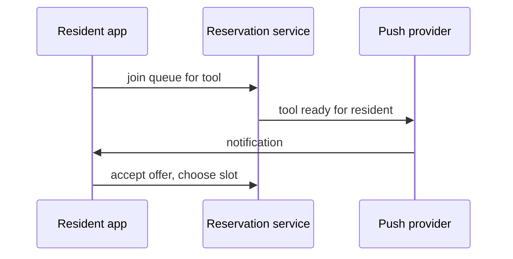

# Tool Library Reservations: Design

Status: in progress. Design basis: [the brainstorm draft](tool-library-draft.md); no spec governs this work, by the
user's decision recorded there.

## Reservation Flow

A resident opens the app, picks a tool, and joins its queue. When the tool is returned, the service offers it to the
first resident in the queue through a push notification. The resident accepts in the app within 24 hours and picks a
pickup slot; otherwise the offer passes to the next resident.

## Components

- **Resident app**: the only interface for residents. Holds the resident's login session.
- **Reservation service**: owns queues, offers, and pickup slots.
- **Push provider**: delivers offer and reminder notifications.
- **Volunteer view**: a screen in the same app listing the day's pickups.

## Open Questions

- Offer expiry: 24 hours is a placeholder until volunteers confirm it.
- Push provider choice is pending a cost comparison.
