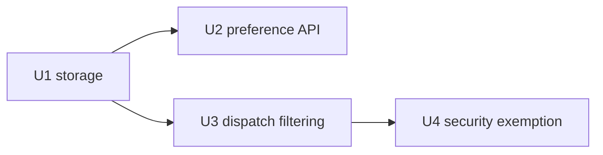

# Implementation Plan: Notification Preferences

Status: Accepted

Design: [notification-preferences.md](../design/notification-preferences.md)

## Overview

Storage comes first because both the preference API and dispatch filtering read it. The preference API and dispatch
filtering can then proceed in either order. The final unit adds the security-category exemption to dispatch, which
depends on the filtering unit.

## Preflight

Run `just test` and `just lint` on a clean checkout to confirm the baseline passes before starting.

## Units

### U1: Preference storage

Add migration `0003_preferences.sql` and `get_preferences` with the missing-row default.

Verification: a test that a user with no row gets both channels on, and one that a stored row is returned as written.
`just test` and `just lint` pass.

### U2: Preference API with authorization

Add `set_preferences` with the actor check from the design.

Verification: tests that the user and an account administrator can change preferences, and that another user gets
`PermissionError` and the stored row is unchanged.

### U3: Dispatch filtering

Add the `category` argument to `dispatch` with default `"general"` and filter channels by stored preference.

Verification: tests that a disabled channel is skipped for general notifications, and that callers without `category`
still send on all enabled channels.

### U4: Security exemption

Send `"security"` notifications on every channel regardless of preferences.

Verification: a test that a user with both channels off still receives a security notification on both.

## Review Strategy

After every commit, start a fresh agent session and have it review the whole repository against the design and this
plan. After every fix for a review finding, start another fresh agent session and repeat the whole-repository review.
A unit is complete when the latest whole-repository review reports no findings.

## Final Check

All units complete, `just test` and `just lint` pass, and the design's behavior holds end to end.
