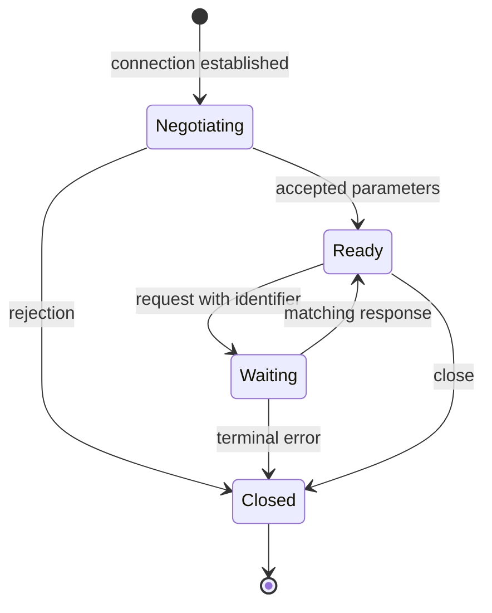

# Framing and Field Inference

## Preserve Transport Semantics

TCP is an ordered byte stream, not an application message transport. One message can span segments; one segment can\
contain several messages. Retransmissions, out-of-order delivery, overlaps, capture gaps, and offload artifacts\
complicate packet-level interpretation. Preserve both directions separately with conversation and byte-offset identity.

Use a reassembly-aware tool and inspect its settings. Wireshark's\
[TCP reassembly documentation](https://wiki.wireshark.org/TCP_Reassembly) explains segment-to-PDU handling. A capture\
with missing bytes cannot be repaired by concatenation or a dissector. Mark the gap and stop or resume only at a\
justified synchronization point. Midstream captures may lack framing or negotiated state.

UDP preserves datagram boundaries but may still contain application fragmentation, multiple records, sequence numbers,\
or retransmission. Identify those layers before treating every datagram as one complete message.

Typical passive entry points, after checking the installed TShark help, include:

```bash
tshark --version
tshark -r capture.pcapng -q -z conv,tcp
tshark -r capture.pcapng -q -z io,phs
tshark -r capture.pcapng -Y 'tcp.stream == 0' -T fields -e frame.number -e tcp.seq -e tcp.len
```

The last command shows transport metadata, not reconstructed application records. Select the relevant stream from\
actual conversation evidence rather than assuming stream zero contains the target. Export with Follow Stream or an\
equivalent reassembly-aware facility and record its direction and output representation.

## Infer Boundaries Before Field Names

Compare fixed-length, delimiter-based, length-prefixed, TLV, and state-dependent framing candidates. For each\
candidate, test exact message consumption across several sizes and sessions. Reject a candidate that aligns one sample\
but drifts on another.

For a length field, determine endian order, width, unit, inclusive/exclusive header treatment, padding, and whether\
compression or encryption changes its meaning. Test zero, small, maximum observed, and boundary lengths. A field that\
tracks packet size may instead count items or describe an inner record.

For TLV, establish header size, nesting, value length versus total length, alignment, repeated fields, unknown tags,\
and terminators. Each iteration must consume bytes or report incomplete/invalid input. Preserve unknown values rather\
than inventing semantics from one occurrence.

For a magic or version candidate, examine false matches inside payloads, per-direction variants, and negotiation. Port\
numbers and short signatures are recognition leads, not sufficient protocol identification.

## Infer Meaning Through Controlled Differences

Group captures by one changed variable where possible: user action, payload size, command, version, authentication\
state, or result code. Record exact bytes and all uncontrolled differences. Infer opcodes from stable relationships\
between action, payload, and response rather than naming the most frequent byte an opcode.

Counters may be sequence numbers, timestamps, lengths, identifiers, checksums, or changing input. Compare behavior\
across reconnects and repeated requests. Identify request/reply correlation independently of TCP sequence numbers.

For a checksum candidate, establish covered bytes, excluded fields, endian representation, initialization/finalization,\
and algorithm parameters. Check several distinct messages, including leading zeros. A single matching CRC is weak\
evidence. Authentication tags require key-dependent validation; do not describe them as ordinary checksums.

## Recover Conversation State

Record initiating side, handshake, negotiation, authentication, request/reply rules, unsolicited messages, errors,\
retries, closure, and timeout behavior. Distinguish application state from transport connection state. Capture multiple\
transactions and reconnects to detect session-bound identifiers and replay restrictions.

Use an explicit transition model. For a simple synthetic request protocol:



This is a modeling shape, not an asserted target protocol. Annotate observed transitions with message evidence; leave\
missing branches unknown instead of filling them from expectation.
